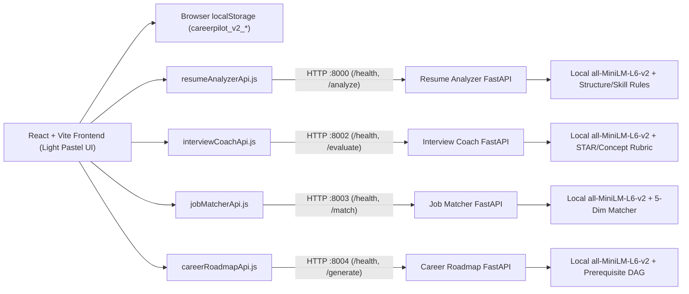

# ELEVSKILL AI

> **Build Skills. Elevate Your Future.**

**ELEVSKILL AI** is a privacy-first career preparation platform for college students, freshers, and early-career professionals. It pairs a light-pastel React + Vite interface with four locally executed Python FastAPI NLP/ML services.

> **Scope & Honesty Note:** All four ML engines run locally using `sentence-transformers/all-MiniLM-L6-v2` and transparent rule/rubric logic. ELEVSKILL AI does **not** use paid external AI APIs, does **not** fetch live job-market listings, and does **not** predict hiring or interview selection probability.

---

## 1. Main Features & Application Modules

1. **Dashboard**: Displays user profile summary, dynamic roadmap readiness, latest Resume Analyzer, Job Matcher, and Interview Coach results, Weekly Study Tracker summary, and a live Recent Activity feed.
2. **Resume Analyzer** *(FastAPI Port `8000`)*: Supports **PDF resume upload** (with editable extracted-text preview before analysis) as well as manual text input. Evaluates resume structure, Markdown/special-character formatting, fresher vs. experienced profile detection, education detection, categorized technical skills, writing quality, and semantic relevance against an optional job description.
3. **Resume Vault**: Privacy-controlled storage for explicitly saved resumes with view, edit, reanalyze, reuse in Job Matcher, copy, original PDF download (when retained), and delete actions.
4. **Resume Builder**: Editable structured sections (Contact, Summary, Education, Technical Skills, Projects, Experience, Internships, Certifications, Achievements), template selection, live preview, and print-ready PDF export.
5. **Interview Coach** *(FastAPI Port `8002`)*: **153-question bank across 17 domains** with Beginner/Intermediate/Advanced filtering, Previous/Next/non-repeating Random Practice, evaluation history, STAR assessment for behavioral prompts only, and technical rubrics for technical categories.
6. **Career Roadmap** *(FastAPI Port `8004`)*: Starts with an honest empty state, includes a searchable categorized skill catalog (`Programming`, `AI/ML`, `Data Science`, `Web Development`, `Backend`, `Databases`, `Cloud`, `Tools`) with duplicate prevention, `Not Started` / `In Progress` / `Completed` statuses, `Already Known` vs. `To Learn` toggles, and synchronized AI-powered prerequisite-ordered recommendations.
7. **Job Matcher** *(FastAPI Port `8003`)*: Five-dimensional profile-to-job alignment (`required_skill_coverage`, `semantic_relevance`, `project_experience_alignment`, `preferred_skill_coverage`, `education_qualification_alignment`) normalized strictly over applicable dimensions with consistent skill matching and required vs. preferred missing skill separation.
8. **Study Tracker**: Dedicated weekly study tracker with weekly target, completed/remaining hours, progress percentage, session history with optional notes, subject breakdown, previous-week comparison, weekly summary, and roadmap suggestions.
9. **Settings & Optional Onboarding**: Friendly optional onboarding, editable profile (`name`, `degree`, `institution`, `graduationYear`, `status`, `targetRole`, `skills`, `careerInterests`, `weeklyGoalHours`), notification & study reminder toggles, light pastel palette switcher (`Classic Lavender`, `Soft Rose & Pink`, `Powder Blue & Mint`), and full data reset with confirmation.

---

## 2. Technology Stack & Architecture

- **Frontend:** React 18, Vite 5, JavaScript, modular CSS (`src/styles/`), Lucide icons, `localStorage` persistence (`careerpilot_v2_*` keys).
- **Backend ML Services:** Python 3.11, FastAPI, Uvicorn, Pydantic v2, `sentence-transformers` (`all-MiniLM-L6-v2`, Apache-2.0), `scikit-learn`, `numpy`, `torch` (CPU).
- **Local / Offline Operation:** Each service loads its locally saved `models/all-MiniLM-L6-v2/` directory once during FastAPI `lifespan` startup with `local_files_only=True`. No resume text, interview answers, or profile data ever leave your machine.



---

## 3. Project Directory Structure

```text
CareerPilot AI/
├── index.html
├── package.json
├── vite.config.js               # Ignores ml/**/.venv/** from Vite file watching
├── .env.example                 # Optional API URL overrides
├── start_careerpilot.ps1        # Windows helper to launch all 4 APIs + Vite
├── src/
│   ├── App.jsx                  # Centralized state & localStorage sync
│   ├── components/              # Reusable Card, StatCard, ProgressBar, Badge, Button, Sidebar, Topbar
│   ├── data/sampleData.js       # Empty profile defaults, question bank, optional sample text
│   ├── pages/                   # Dashboard, ResumeAnalyzer, InterviewCoach, CareerRoadmap, JobMatcher, Settings
│   ├── services/                # resumeAnalyzerApi.js, interviewCoachApi.js, jobMatcherApi.js, careerRoadmapApi.js
│   ├── styles/                  # Light pastel theme tokens, global & layout CSS
│   └── utils/dashboardStore.js  # Safe localStorage persistence & dynamic calculations
└── ml/
    ├── ResumeAnalyzer/          # Port 8000 — main.py, resume_analyzer.py, evaluate_resume_analyzer.py, test_api.py, .ipynb, models/, artifacts/
    ├── InterviewCoach/          # Port 8002 — main.py, interview_coach.py, evaluate_interview_coach.py, test_api.py, .ipynb, models/, artifacts/
    ├── JobMatcher/              # Port 8003 — main.py, job_matcher.py, evaluate_job_matcher.py, test_api.py, .ipynb, datasets/, models/, artifacts/
    └── CareerRoadmap/           # Port 8004 — main.py, career_roadmap.py, evaluate_career_roadmap.py, test_api.py, .ipynb, datasets/, models/, artifacts/
```

---

## 4. Installation & Local Setup

### Frontend (Node.js 22+)
```powershell
Set-Location "d:\CareerPilot AI"
npm.cmd install
```

### Python ML Environment (Python 3.11)
All four ML services share `ml/ResumeAnalyzer/.venv`:
```powershell
python -m venv "d:\CareerPilot AI\ml\ResumeAnalyzer\.venv"
& "d:\CareerPilot AI\ml\ResumeAnalyzer\.venv\Scripts\python.exe" -m pip install -r "d:\CareerPilot AI\ml\ResumeAnalyzer\requirements.txt"
```

---

## 5. Starting the Application

### Option A — Quick Windows Startup Script
```powershell
Set-Location "d:\CareerPilot AI"
powershell -NoProfile -ExecutionPolicy Bypass -File .\start_careerpilot.ps1
```
> Note: On Windows systems with `Restricted` PowerShell execution policy, pass `-ExecutionPolicy Bypass` as shown above. Allow ~60 seconds on CPU for all four ML services to load `all-MiniLM-L6-v2` before all `/health` endpoints report ready. Close the four spawned PowerShell windows and press `Ctrl+C` in the Vite window to shut down.

### Persistence / Database Note
CareerPilot AI uses browser `localStorage` (`careerpilot_v2_*` keys) for all user profile, roadmap, study session, and activity persistence — no external database server setup is required.

### Option B — Manual Startup (5 Terminals)
```powershell
# Terminal 1 — Resume Analyzer (Port 8000)
Set-Location "d:\CareerPilot AI\ml\ResumeAnalyzer"
& "d:\CareerPilot AI\ml\ResumeAnalyzer\.venv\Scripts\python.exe" -m uvicorn main:app --host 127.0.0.1 --port 8000

# Terminal 2 — Interview Coach (Port 8002)
Set-Location "d:\CareerPilot AI\ml\InterviewCoach"
& "d:\CareerPilot AI\ml\ResumeAnalyzer\.venv\Scripts\python.exe" -m uvicorn main:app --host 127.0.0.1 --port 8002

# Terminal 3 — Job Matcher (Port 8003)
Set-Location "d:\CareerPilot AI\ml\JobMatcher"
& "d:\CareerPilot AI\ml\ResumeAnalyzer\.venv\Scripts\python.exe" -m uvicorn main:app --host 127.0.0.1 --port 8003

# Terminal 4 — Career Roadmap (Port 8004)
Set-Location "d:\CareerPilot AI\ml\CareerRoadmap"
& "d:\CareerPilot AI\ml\ResumeAnalyzer\.venv\Scripts\python.exe" -m uvicorn main:app --host 127.0.0.1 --port 8004

# Terminal 5 — React + Vite Frontend (Port 5173)
Set-Location "d:\CareerPilot AI"
npm.cmd run dev -- --port 5173
```

---

## 6. API Endpoint Reference

| Service | Port | Health | Primary Endpoint |
|---|---:|---|---|
| Resume Analyzer | `8000` | `GET /health` | `POST /analyze` (`{ resume_text, job_description? }`) |
| Interview Coach | `8002` | `GET /health` | `POST /evaluate` (`{ answer_text, category, question_id?, question_text?, expected_concepts? }`) |
| Job Matcher | `8003` | `GET /health` | `POST /match` (`{ profile, job }`) |
| Career Roadmap | `8004` | `GET /health` | `POST /generate` (`{ target_role, experience_level?, education?, known_skills?, completed_skills?, project_descriptions?, resume_text? }`) |

---

## 7. Testing & Evaluation Commands

```powershell
# Frontend production build
npm.cmd run build

# Automated FastAPI pytest suites (run from each ML folder)
& "d:\CareerPilot AI\ml\ResumeAnalyzer\.venv\Scripts\python.exe" -m pytest -v test_api.py

# Offline ML engine evaluation scripts
& "d:\CareerPilot AI\ml\ResumeAnalyzer\.venv\Scripts\python.exe" evaluate_resume_analyzer.py
& "d:\CareerPilot AI\ml\ResumeAnalyzer\.venv\Scripts\python.exe" evaluate_interview_coach.py
& "d:\CareerPilot AI\ml\ResumeAnalyzer\.venv\Scripts\python.exe" evaluate_job_matcher.py
& "d:\CareerPilot AI\ml\ResumeAnalyzer\.venv\Scripts\python.exe" evaluate_career_roadmap.py
```

---

## 8. Demonstration Workflow

1. Open `http://localhost:5173` in Chrome. Confirm the initial empty state (`Guest User`, `0%` roadmap, `No analysis yet`, `0 hrs` logged, `No recent activity`).
2. Open **Settings**, enter your name, education, target role (e.g., `Frontend Developer` or `Data Scientist`), experience level, and weekly study target, then click **Save Preferences**.
3. Open **Resume Analyzer**, click **Load Sample Text** (or paste a resume), and click **Analyze Resume** to view structure, skills, MiniLM semantic relevance, and Dashboard updates.
4. Open **Interview Coach**, test both a `Behavioral` answer (shows STAR breakdown) and a `Frontend & React` answer (omits STAR).
5. Open **Job Matcher**, compare a resume against a job description to inspect required vs. preferred skill gaps and traceable profile evidence.
6. Open **Career Roadmap**, review prerequisite-ordered `Recommended Next Skills`, click **Add to My Roadmap**, and check off completed skills to watch Dashboard progress update live.
7. Return to **Dashboard**, log a study session in the **Weekly Study Tracker**, and refresh Chrome to verify `localStorage` persistence.

---

## 9. Known Limitations & Privacy

- **Evaluation Methodology:** All four ML engines are evaluated against curated, PII-free development benchmarks (not human-graded real-world hiring datasets).
- **Privacy:** User inputs are processed in-memory by local FastAPI endpoints and never logged or sent to external services; frontend state is stored locally in browser `localStorage`.
- **Single-User Local Mode:** No authentication or cloud database is connected yet.
